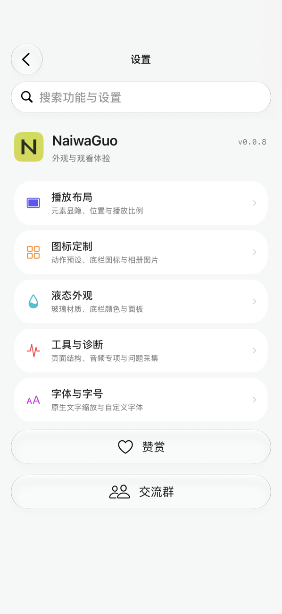
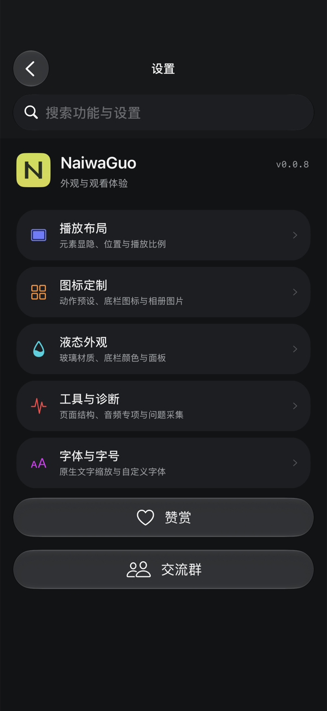
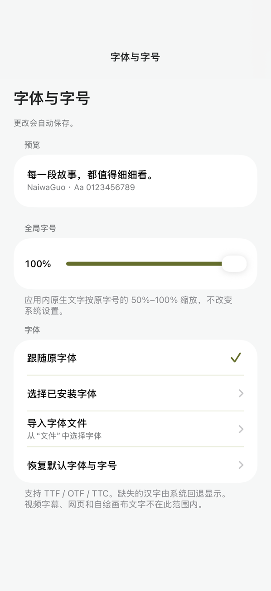
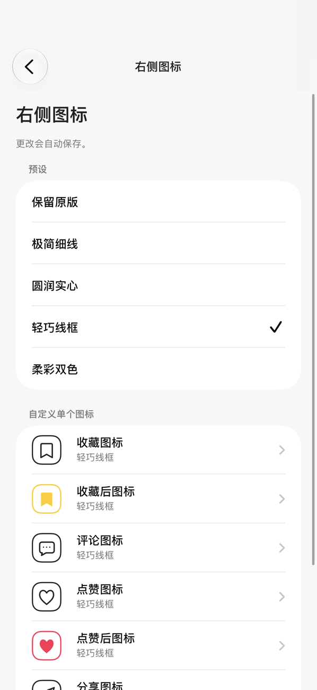
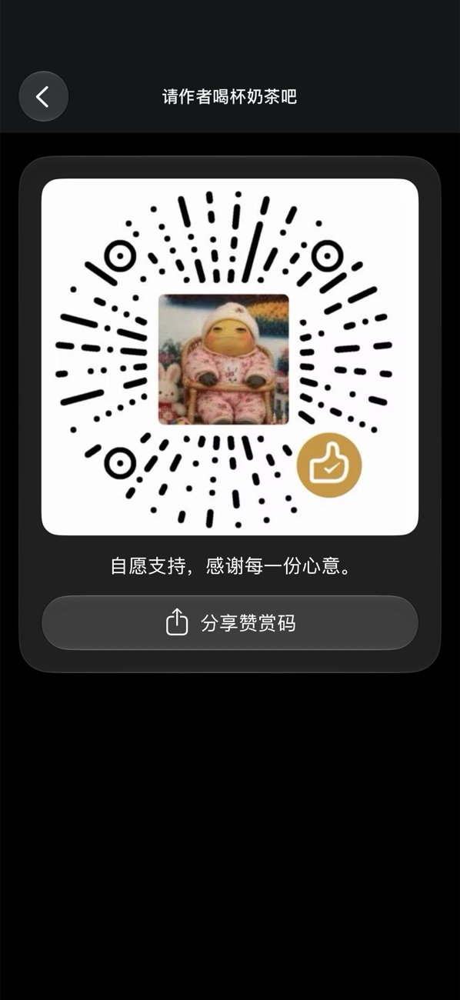
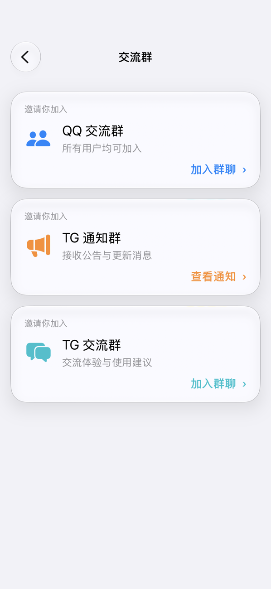

# NaiwaGuo

红果短剧 iOS 原生界面定制插件。简洁设置、跟随系统浅深色、彩色功能图标与黄绿色控件点缀。

**当前版本：0.0.8 · 预发布，真机效果待补充。** 项目现为私人维护，源码仅用于内部备份。基于红果 7.4.3 接口适配，目标为 com.phoenix.video / Eggplant。

[私人仓库](https://github.com/XIaodou0416/NaiwaGuo) · [安装说明](INSTALL.md) · [验证记录](docs/VALIDATION.md) · [免责声明](DISCLAIMER.md)

## 插件功能

| 模块 | 可以设置什么 |
| --- | --- |
| 播放布局 | 显示/隐藏头像、右侧动作、顶部标签与视频信息；调整位置和大小；竖屏全屏；宽屏与方形视频保留原尺寸和位置；系统状态栏交还宿主管理。 |
| 浮动底栏 | DYKiller 同源原生胶囊与独立圆钮；普通/清透液态；上滑收缩到左侧、右侧或中间，下滑或点击展开；可显示红果账号头像。 |
| 底栏定制 | 文字、图标、图文三种显示；胶囊高度、长度、独立圆钮大小；图标、选中/未选中颜色及项目显隐；按键触动反馈开关；独立按钮可选搜索、首页、剧场、商城、我的或插件设置。 |
| 播放页液态 | 顶部频道、合集返回、倍速与更多、全集入口、右侧按钮、评论区、分享/长按/倍速面板及评论玻璃透明度。 |
| 图标定制 | 原版与四套动作图标；收藏/点赞按真实状态变化；支持相册图片和 SF Symbols，自定义图标优先。 |
| 字体与字号 | 原生文字缩放 50%–100%；选择已安装字体、导入 TTF/OTF/TTC（最大 50 MB）；一键恢复。 |
| 设置搜索 | 搜索功能后直达对应页面，开关项滚动定位并高亮。 |
| 调试工具 | DYKiller 同源可拖动扳手、整页 ZIP、五秒音频专项 ZIP；红果探针与可选 FLEXKing 只读接口。 |
| 作者与交流 | “请作者喝杯奶茶吧”玻璃赞赏卡片与原始赞赏码；QQ / TG 独立邀请卡片。 |

首次使用的功能开关默认关闭，开启后保留选择。支持 iOS 15 及以上：**iOS 15–25 使用公开 UIKit 磨砂底栏，iOS 26+ 使用原生液态玻璃**；自动收缩仅在 iOS 26+ 的 iPhone 启用。原生液态兼容层仅在 iOS 26+ 自动启用，无需手动开关。宿主版本、注入方式与系统私有接口会影响兼容性。字体覆盖 UILabel、UITextField、UITextView、YYLabel，不覆盖视频内文字、网页及 Compose/DanceUI 自绘文字。

## 功能界面

以下是 **0.0.8 在 iOS 模拟器中实际运行的设置界面**，不代表红果真机效果。底栏演示使用合成背景。

<table>
<tr><td align="center">设置 · 浅色</td><td align="center">设置 · 深色</td><td align="center">底栏与收缩</td></tr>
<tr><td></td><td></td><td></td></tr>
<tr><td align="center">字体与字号</td><td align="center">右侧图标</td><td align="center">调试导出菜单</td></tr>
<tr><td></td><td></td><td></td></tr>
<tr><td align="center">赞赏 · 浅色</td><td align="center">赞赏 · 深色</td><td align="center">交流群邀请</td></tr>
<tr><td></td><td></td><td></td></tr>
</table>

[更多底栏、收缩与交流入口截图](docs/SCREENSHOTS.md)

### 真机效果

**等待作者后续提供真机截图或录屏。** 收到后补充机型、iOS、红果及插件版本，再更新验证结论。目前没有把模拟器截图标成真机效果。

## 0.0.8 更新

- 修复作者无法关注自己的问题：当前红果登录账号 ID 为 106173406210 时直接解锁，不查询自关注关系，也不提示关注自己。退出登录或切换为其他账号后重新核验。

## 保留的 0.0.7 功能

- 新增“主页发弹幕按钮”隐藏开关，入口位于“播放布局 → 播放页元素显示”，不关闭弹幕内容。
- 使用前核验是否关注红果作者 106173406210。未关注或校验失败时，插件功能暂停、设置列表置灰；已保存设置不会删除。
- 每次启动、回到前台及进入设置时重新核验。点击“确认关注”后调用红果原生关注流程，再查询服务端状态，验证通过后才解锁。
- 设置页增加带原赞赏码的赞助弹窗：“直接关闭”仅关闭本次，“以后再也不弹”持久保存选择。赞助不是解锁条件。
- 仓库设为私有；构建自动生成带版本、提交信息和 SHA-256 的独立源码备份，保留旧版备份。

仍支持 iOS 15+；15–25 使用磨砂底栏，26+ 使用原生液态。关注适配针对本地检查的红果 7.4.3 接口，实际账户和网络仍需真机验收。

## 调试工具怎么用

1. 开启 **工具与诊断 → 调试工具**，出现可拖动扳手；长按扳手可回到插件设置。
2. 出现问题时，点扳手 → **导出本页 zip**，保存窗口、视图/控制器树、图层、类声明、截图及红果状态。
3. 排查声音时，开启调试后**彻底退出并重启红果**，选择 **导出音频专项 zip**，选择“播放中 / 已暂停 / 静音播放中”，保持五秒。
4. 导出走系统分享面板。**截图、界面文字与三秒播放声音可能含私人内容，请先检查再分享。** 插件不自动上传诊断包。

字段与限制见 [调试工具说明](docs/DEBUG_TOOLS.md)。没有取得可读 PCM 时会写明实际观测和覆盖情况，不伪造 WAV。

## 安装与开发

仓库只用于私人维护。安装文件与源码备份分开存放；源码不作为公开附件发布。每次构建自动保存至 dist/private-backups/版本号/，不会覆盖旧快照。不要同时加载多个版本；升级后完全退出红果再打开。详见 [安装说明](INSTALL.md)。

构建需要 macOS、带 iOS 26 或更新 SDK 的 Xcode、Python 3；测试需要 iPhone 模拟器。

~~~sh
bash scripts/build.sh
bash scripts/test-simulator.sh
bash scripts/test-access-ui.sh
bash scripts/test-defaults.sh
bash scripts/test-search-navigation.sh
bash scripts/test-native-ui.sh
bash scripts/test-debug-tools.sh
~~~

测试优先选择已启动的 iPhone 模拟器，也可设置 NG_SIM_DEVICE。测试自带原创图标，默认不需要宿主 IPA；NG_TEST_IPA 仅供本机可选图标读取。构建与测试输出在 dist/，不提交宿主二进制和个人采集包。私人备份规则见 [AGENTS.md](AGENTS.md)。

## 参考项目与致谢

| 项目与链接 | 对应使用 |
| --- | --- |
| [HierarchThurs/DYKiller](https://github.com/HierarchThurs/DYKiller) | 固定提交 bb11ab1d9cba9733d6720f0e2746dec21d6c6fe4；液态底栏、自动收缩、尺寸/内容规则、调试导出、类声明、音频旁路和信号分析。MIT。 |
| [facebook/fishhook](https://github.com/facebook/fishhook) | 音频 C 符号重绑定，使用 DYKiller 随附的隔离版本，保留原版权和分发条件。 |

赞赏与交流群布局参考作者提供的 NaiwaEase 0.0.22 本地交接包；没有已确认的公开项目链接。使用本项目的原始赞赏码与群链接，未引入其授权或账号逻辑。

原文件、对应模块、改动及完整许可见 [第三方声明](THIRD_PARTY_NOTICES.md)。引用不表示参考项目作者为本项目背书。

## 请作者喝杯奶茶吧

自愿支持开发，不是购买功能，也不构成更新期限或兼容性承诺。插件内展示相同的原始赞赏码。

- [QQ 交流群](https://qm.qq.com/q/w9rb2DnAoE)
- [TG 通知群](https://t.me/beans0416)
- [TG 交流群](https://t.me/beans1011)

## 免责声明与许可

本项目是独立、非官方界面定制工具，与红果短剧及其运营主体没有官方合作或背书关系。请遵守适用法律、平台规则和第三方素材许可。软件按现状提供，不保证所有设备和版本可用；诊断包由使用者自行决定是否分享，请勿公开账号信息或私人内容。

详见 [免责声明](DISCLAIMER.md)。原创代码采用 [MIT License](LICENSE)，第三方代码遵循各自许可；本说明不额外收窄 MIT 授予的软件使用权。
