# 功能界面截图

顶部使用宿主红果原图标，功能入口使用单色线性图标。以下均为 0.1.1 模拟器实际运行界面；底栏背景是合成内容。真机效果等待作者提供，届时单独记录机型与版本。

| 普通液态 | 清透液态 |
| --- | --- |
|  | 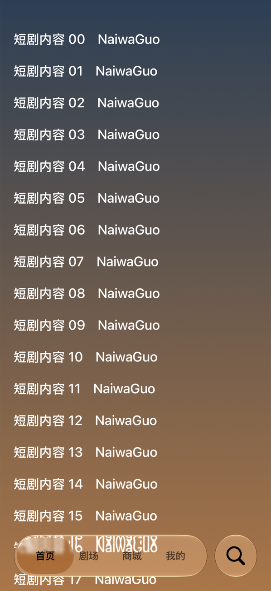 |

| 左侧收缩 | 右侧收缩 |
| --- | --- |
|  | 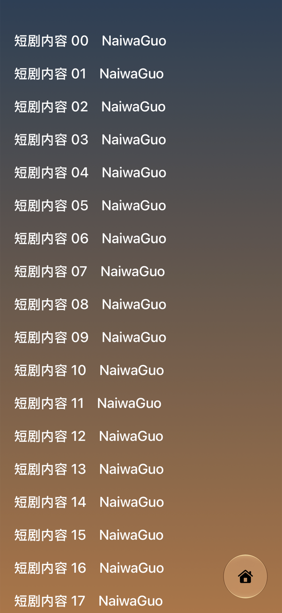 |

| 独立按钮与头像 | 交流群邀请 |
| --- | --- |
|  |  |

| 赞赏 · 浅色 | 赞赏 · 深色 |
| --- | --- |
|  |  |

| 交流群 · 浅色 | 交流群 · 深色 |
| --- | --- |
|  |  |

## 真机效果

待提供。当前不声称已完成红果真机验收。

## 居中收缩与头像

模拟器中的原生底栏。头像为合成字母图案，用于验证红果账号头像接入，不是用户真实头像。

| 居中收缩 | 账号头像图案 |
| --- | --- |
| 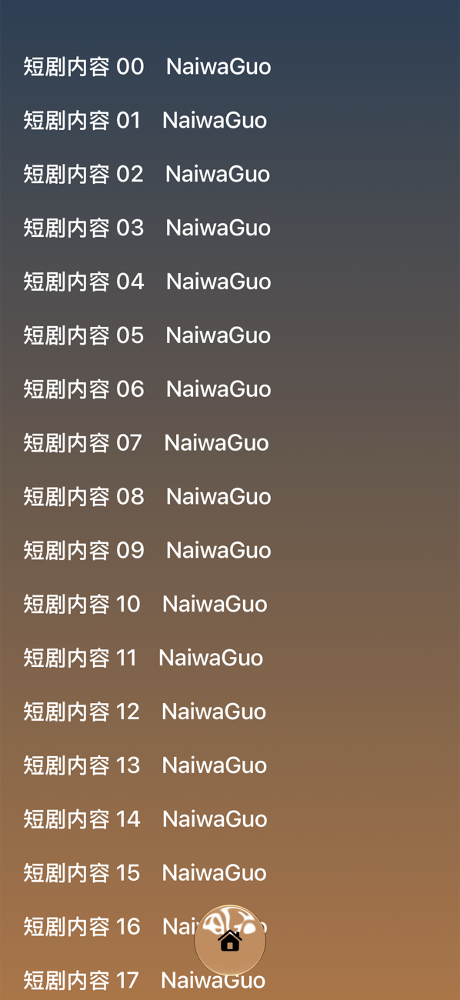 | 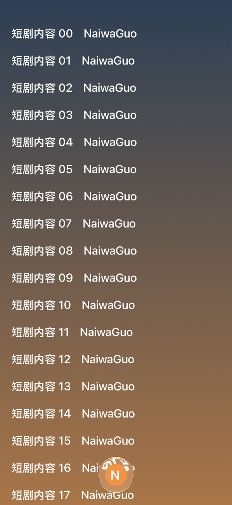 |

## 低版本磨砂底栏

以下为 iOS 27 模拟器强制运行 iOS 15–25 分支的截图，不是 iOS 15 设备截图。

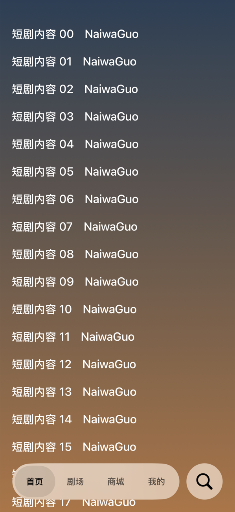

## 新版设置与入口

所有功能直接可用，不依赖红果登录账号或关注状态。以下为模拟宿主界面，赞赏码使用插件内原图。

| 奶蛙功能列表 | 纯文字设置入口 |
| --- | --- |
| 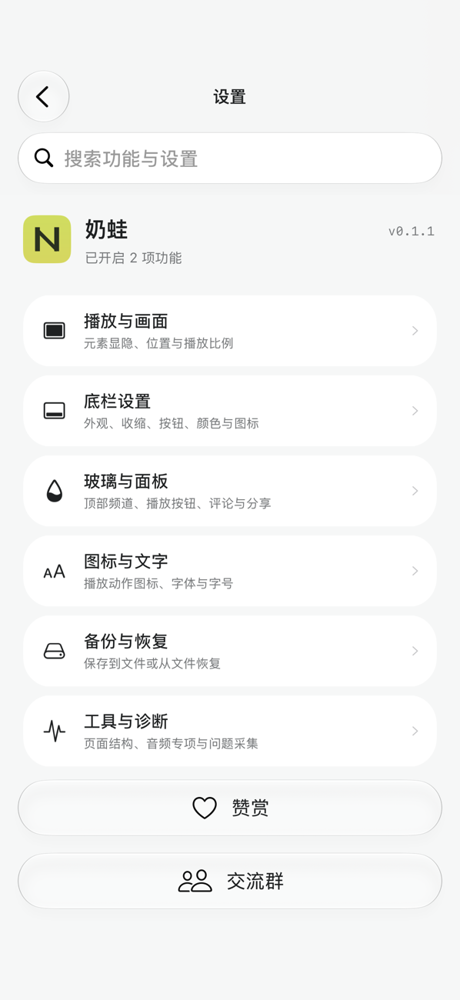 | 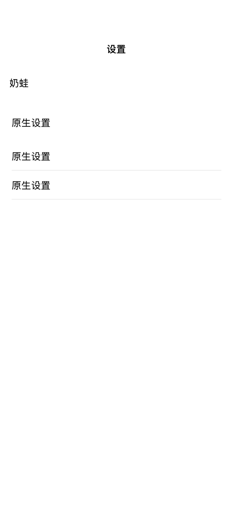 |

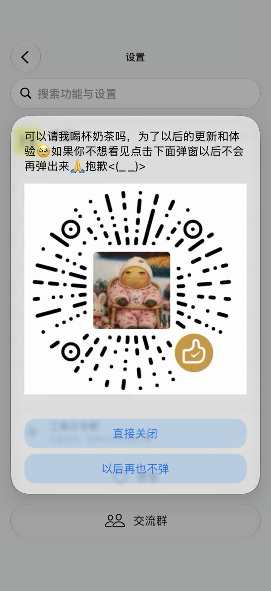

## 备份与恢复

| 文件备份与恢复 | 深色备份界面 |
| --- | --- |
| 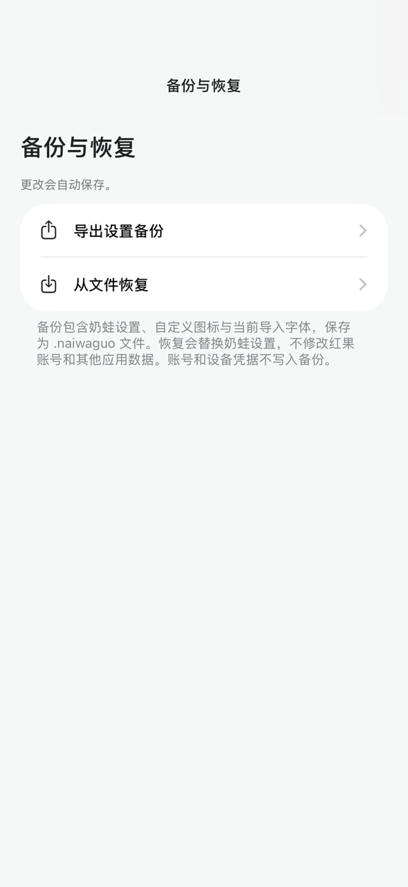 | 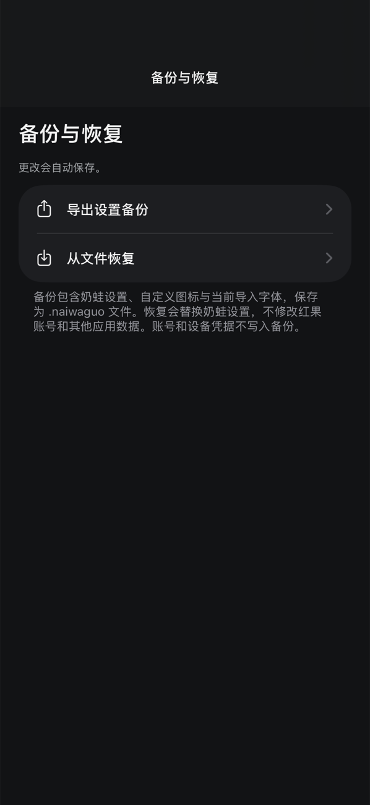 |

## 封禁账号

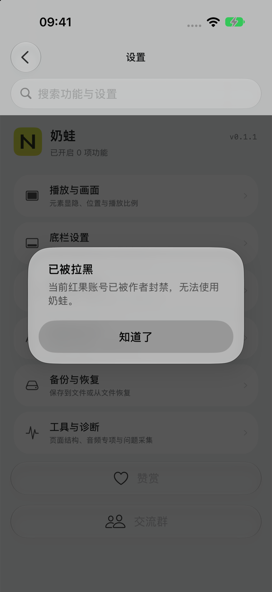

使用本地合成账号演示，不包含真实用户数据。
